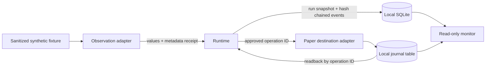

# Synthetic pilot security and operations review pack v0.1

**Status:** draft for product, security, legal/compliance, and operations
review. No organization has reviewed or approved it. The current system is a
local synthetic case 10 coordinator, not a live Terminal or destination
connection. [Issue #2](https://github.com/newdarwindev/runspindle_for_bloomberg/issues/2)
remains the access and data-rights gate. Critical items below block rollout.

## Data flow and trust boundaries

All nodes run locally. There is no credential vault, network call, Bloomberg
session, model context, external journal, or production telemetry. The source
adapter copies only fixed case 10 fields. Receipts contain metadata and
hashes, not credentials. The SQLite file contains synthetic values and actor,
account, and session identifiers. Treat a future live source, model, browser,
and destination as separate trust boundaries requiring review.

## Threat and control matrix

| Threat | Current synthetic control and test | Residual risk / pilot gate |
| --- | --- | --- |
| Wrong account, operator, target, or session | Bound IDs checked before transitions; tests in `test_runtime.py` and `test_adapters.py`. | IDs are caller supplied, not authenticated. Real identity and entitlement binding is critical. |
| Stale lease or source mark | Lease/deadline and source age checks fence submission; `revoke` fences work after expiry. | No central revocation service or session rebinding. Critical for live use. |
| Prompt injection in source or portal text | Exact observation field allowlist, ISO dates, numeric calculation, and synthetic ID check reject extra text; no model consumes source prose. | Future live text, browser content, and model prompts need isolation and adversarial testing. |
| Credential leakage | Unknown observation and receipt fields are rejected; synthetic fixture has no credential; source adapter omits extra fixture keys. | No secrets manager, redaction service, or approved live log policy. Critical before access. |
| Unauthorized action or approval confusion | Synthetic accounts only; preview, exact draft hash, approval, one-submission budget, and state fence precede local journal write. | Local actor ID is not a real authentication or segregation-of-duties control. Critical. |
| Duplicate or uncertain effect | Stable operation ID, journal uniqueness, unknown-effect pause, readback before any further action; replay and runtime tests. | Separate systems can acknowledge late or partially; real idempotency and readback must be proven. Critical. |
| Corrupted or poisoned audit data | Event chain and final snapshot hashes; tests detect changed observation/draft. | SQLite administrator can replace both data and hashes; no external anchor or immutable store. |
| Poisoned feedback | No feedback ingestion, learning, or model update path exists. | Any later feedback pipeline needs provenance, reviewer separation, and quarantine. |
| Privacy and redistribution | Only fictional values; no protected market data or personal customer records in fixture. | Retention, export, deletion, privacy notice, and license rights are undecided. Critical. |

The controls above are local design checks, not a security certification.
Source receipt hashes establish fixture identity within this repository only.

## Failure injection evidence

Run `python3 -m unittest discover -s tests -v` and
`python3 scripts/replay_case10.py --check`. The cases below are deterministic
software tests; no network or real destination was used.

| Injection | Observed synthetic result | Repair / measurement limit |
| --- | --- | --- |
| Response lost before or after commit | Unknown effect; duplicate submit rejected; later matching readback confirms only the after-commit case. | Readback required; real recovery latency not measured. |
| Process interrupted before adapter call | Reopen database, `recover` marks uncertain, no auto-submit. | Operator must reconcile; repair time not measured. |
| Delayed readback | First absence remains unknown; later injected row can confirm without a second submission. | No real delivery-delay distribution measured. |
| Partial or mismatched delivery | Wrong journal instrument/draft pauses; never accepted. | Manual destination investigation required. |
| Corrupted run snapshot | `verify_chain` fails after artifact change. | Preserve file and investigate; no external anchor. |
| Restore older database backup | Explicit `quarantine_after_restore` fences the approved run; absent local readback stays unknown. | Restored DB cannot prove whether a later external effect occurred. Manual external reconciliation is mandatory. |
| Lease expires during uncertain effect | `revoke` fences new work; bound owner can still read back. | A real incident needs authenticated break-glass and account revocation. |

Synthetic tests use a fixed clock. They verify state and repair path, not
elapsed recovery time, human-active time, or an SLO. Those measurements need
instrumented pilot runs and an assigned support owner.

## Incident and recovery runbook

1. Stop new submissions and record the run ID, operation ID, account, session,
   actor, and last known state. The bound owner can call `revoke` even after
   lease expiry. For a restored database, quarantine each possibly effected
   run before resuming any work.
2. Preserve a consistent SQLite backup and the event-chain check result.
   Do not edit events or reuse an operation ID to make a test pass.
3. Read back the destination by operation ID and compare account, instrument,
   and draft hash. An absent or mismatched result remains unresolved; never
   retry a consequential action merely because a response was lost.
4. Escalate access, data-rights, credential, or unauthorized-effect incidents
   to the named security/compliance and product owners. Those owners have not
   yet been assigned for a pilot. Revoke live credentials outside this runtime
   if a future adapter is involved.
5. Record timeline, source and destination receipts, affected data, operator
   actions, repair work, and a reviewer decision. Resume only after the owner
   approves a new bounded run with fresh source evidence.

The current local identity check is not a production break-glass mechanism.
No live credential or account can be revoked by this repository.

## Monitoring and service ownership

`python3 scripts/monitor_synthetic.py path/to/runs.sqlite` reports distinct
queued operations (`begin_submission`), emitted adapter attempts (response or
timeout), stopped runs, local journal rows, confirmed local readbacks, unknown
effects, and interrupted runs. `external_observed_count` and
`source_rejection_count` are `null`: no external system exists, and blocked
source attempts are not persisted. A future pilot must add authenticated
source-denial telemetry, external readback, alerts on unknown/mismatch, and
timestamps for latency and repair metrics.

No numeric SLO or support capacity is established. Before pilot, name an
on-call owner and escalation contact, define alert thresholds, business
hours, incident severity, response and recovery targets, and a stop trigger
for unresolved authorization or unknown effects.

## Pilot risk register

| Risk | Severity | Owner | Required decision before live use |
| --- | --- | --- | --- |
| No approved Terminal/API and destination rights route | Critical | Legal/compliance and account owner: unassigned | Written issue #2 access decision and retention/export rules. |
| Caller-supplied identity and no real least privilege | Critical | Security/engineering: unassigned | Authenticated operator, account/session binding, role separation, revocation. |
| Local journal is not independent external readback | Critical | Engineering/destination owner: unassigned | Prove destination receipt and duplicate behavior on approved route. |
| No external audit integrity anchor or approved data retention | High | Security/privacy: unassigned | Integrity, redaction, deletion, backup, and incident controls. |
| Restore can erase knowledge of later effects | High | Operations: unassigned | External reconciliation and tested rollback procedure. |
| No measured support load, recovery time, or SLO | High | Product/operations: unassigned | Permissioned failure exercises and service ownership. |

**Decision:** block live rollout. A qualified security and operations review,
named owners, issue #2 rights decision, and permissioned failure evidence are
still required for issue #8 acceptance.
