# Case 10: dividend-driven false breakdown (draft v0.1)

**Status:** synthetic paper workflow and operator prototype. This is a candidate
for discussion, not the issue #1 wedge decision or a signed pilot contract.
Issue #2 has no approved access route. The [clickable prototype](../src/prototype.html)
uses local values only and has no Terminal connection, durable ledger, or
trading effect. Source: case 10 in the
[workflow catalog](../assets/runspindle_bloomberg_workflows.csv).

## Bounded task

| Field | Draft contract |
| --- | --- |
| Trigger | Operator reviews a candidate short signal caused by a raw-price decline across two closing dates. |
| Owner | Qualified operator to be named before a pilot; reviewer must be a separate person. |
| Account and session | No live account in this prototype. Pilot must bind an entitled account, operator, session, and approved data route before observation. |
| Exact instrument | One security identifier, dividend event, and two dated closes. `SYNTH-CASE-10` is only a placeholder. |
| Inputs | Prior close, current close, cash dividend per share, dates, observation timestamp, entitlement and corporate-action checks, source references. |
| Freshness | Operator confirms comparable closes and an observation timestamp. A real pilot must specify source latency and a maximum age; until then stale or missing data pauses. |
| Allowed effect | A paper Pass/refusal draft only. No order, trade, external message, or persistent NOTE write is authorized. |
| Budget and deadline | No automated spend or external action. Pilot time and tool budgets and deadline are unset; absence blocks live execution. |
| Stop rules | Wrong instrument, non-comparable dates, missing/unauthorized data, unconfirmed entitlement, other corporate action, or uncertain record effect. |

The example calculation is `(48.90 − 50.00) / 50.00 = −2.2%` raw and
`(48.90 + 1.20 − 50.00) / 50.00 = +0.2%` cash adjusted. The draft decision is
**Pass: reject the raw-price short signal**. This arithmetic is only a
synthetic fixture; a domain reviewer must validate corporate-action and total
return conventions before any pilot.

## Operator journey and state diagram

```mermaid
stateDiagram-v2
    [*] --> Setup
    Setup --> Preview: validate observation
    Setup --> Paused: missing or invalid input
    Preview --> Approved: operator approves paper decision
    Preview --> Paused: exception
    Approved --> Recorded: simulated journal response
    Approved --> Uncertain: response lost or ambiguous
    Uncertain --> Recorded: readback found same operation
    Uncertain --> Preview: readback absent; approval invalidated
    Recorded --> ReviewPending: request independent review
    Preview --> Takeover
    Approved --> Takeover
    Uncertain --> Takeover
    Takeover --> Preview: handback; reapprove
    Setup --> Cancelled
    Preview --> Cancelled
    Approved --> Cancelled
    Paused --> Cancelled
    Uncertain --> Cancelled
```

Setup binds the target and source conditions. Preview shows the calculation
and proposed decision. Approval is specific to that preview revision. A
takeover or changed input invalidates it. The prototype's record and readback
buttons only demonstrate the transitions; they create no real receipt. A
production Console must show pending and unknown effects until independently
reconciled. Cancellation or withdrawal prevents new effects; it cannot undo
an effect already observed.

## Event and receipt contract (proposed)

Every event needs `run_id`, `revision`, `event_id`, `occurred_at`,
`actor_id`, `account_id`, `session_id`, `instrument_id`, `state_from`,
`state_to`, and a hash of the exact input artifact. Observation receipts add
`source_route`, `entitlement_status`, `source_timestamp`, `field_names`, and
redacted source references. Approval receipts add the approver, allowed
effect, deadline, and exact draft hash. Journal receipts add a stable
`operation_id`, destination, submit timestamp, response status, and independent
readback reference. A trace ID is for correlation and never grants authority.

`operation_id = hash(run_id, revision, destination, draft_hash)` is stable
across retries. An unknown submission must not be retried until independent
readback establishes whether that operation exists. A new approval and
revision are required after input changes, takeover, or an absent readback.
No receipt is issued by the current prototype.

## Exception table

| Condition | Required handling |
| --- | --- |
| Missing or stale close/dividend | Pause; request a fresh entitled observation. |
| Wrong security or mismatched dates | Pause; rebind target and invalidate preview. |
| Other corporate action | Pause for qualified review of the return convention. |
| Entitlement or access failure | Refuse observation and record the blocker; do not use a screenshot workaround. |
| Approval declined or expired | Stop before journal submission. |
| Lost response or duplicate delivery | Show unknown effect; read back by operation ID before any retry. |
| Readback mismatch | Stop and escalate; no accepted completion. |
| Operator takeover or withdrawal | Fence automation, invalidate approval, preserve the run record. |

## Independent acceptance gate

A future pilot can count an accepted authorized completion only if a reviewer
checks the exact entitled instrument and dates, source timestamp and rights,
the calculation and decision rule, the operator approval, and the destination
readback for the same operation. A correct refusal is a separate outcome.
The prototype has no independent reviewer or evidence authentication, so no
interaction with it meets this gate.

**Open before pilot:** issue #1 buyer/wedge selection; issue #2 written access
route and data-rights decision; named operator and reviewer; allowed source
and destination; budget/deadline; domain review; actual operator usability
sessions; signed acceptance criteria.
